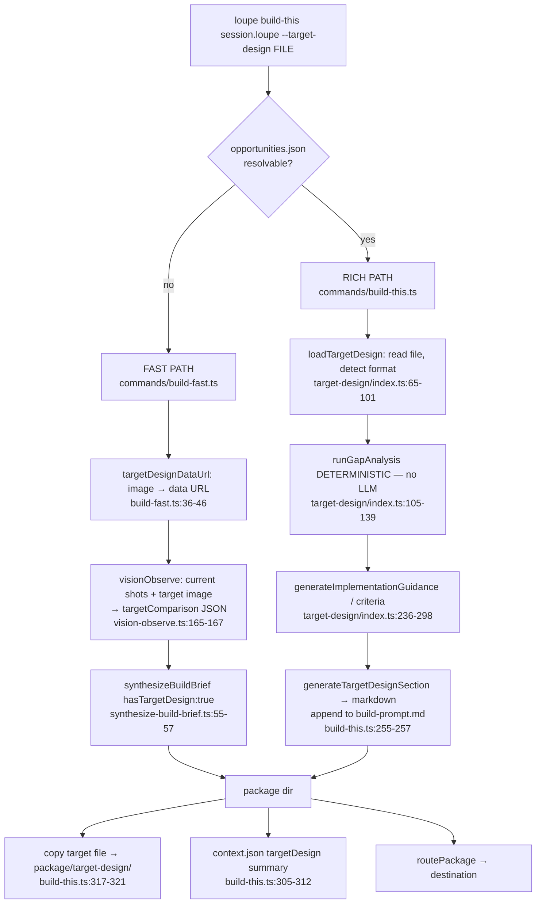
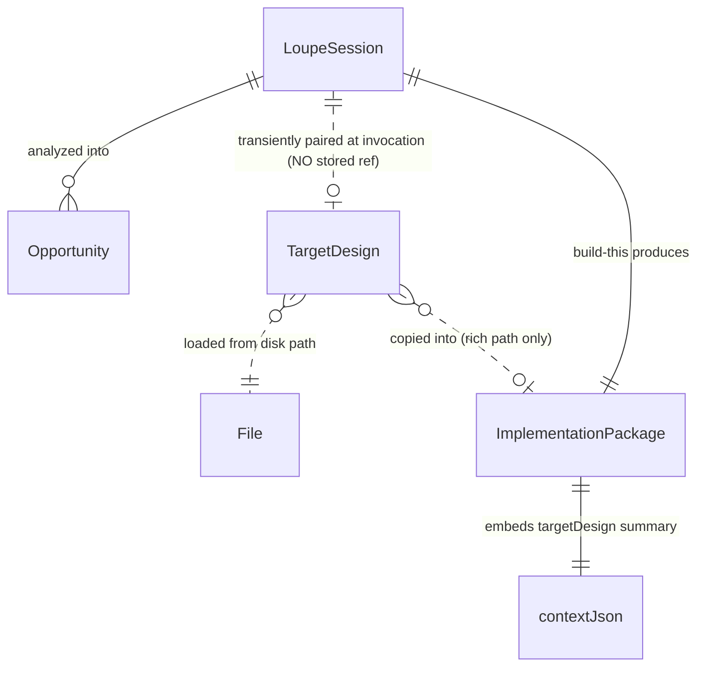

# Target Design — Architecture Investigation

**Type:** Architecture spike (investigation only — no code changed, no prompts changed, no CLI behavior changed)
**Date:** 2026-07-04
**Scope:** Determine whether Target Design Mode is *fundamentally modeled correctly* before further engineering.
**Method:** Every claim below is grounded in the current codebase with `file:line` references. Divergences between the implemented architecture and the stated product vision are called out explicitly.

---

## Decision Outcome (2026-07-04) — Target Design v1.5 shipped

The investigation's recommendation (§12 **Moderate Refactor**) was accepted and implemented. Target Design is **no longer transient** — it is a persisted, content-addressed artifact under the project, and both Build This paths handle it identically. What changed:

- **Persisted artifact.** `~/.loupe/projects/<project>/targets/<id>/` holds `target.json`, `source.<ext>`, `summary.md`. Identity is the source content hash (`t-<hash12>`), so adding the same file twice dedups. See `agent/src/target-design/artifact.ts` and `docs/ARTIFACT_FORMAT.md`.
- **One shared loader/service.** `resolveTargetForBuild()` is the single entry both paths use. The rich/fast divergence documented in §2 is gone: images are vision-compared on **both** paths, HTML/Markdown are included on **both**, and the artifact is copied into the package on **both**. The only remaining difference is brief *depth* (fast = one synthesis; rich = full reasoning + relationships + critic), never target *capability*.
- **CLI.** `loupe target add|list|show`, and `loupe build-this <session> --target-id <id>` to reuse a persisted target. `--target-design <file>` still works and now creates/reuses an artifact under the hood. (Note: the persisted-target flag is `--target-id`, not `--target`, because `--target <name>` already selects the coding agent.)
- **Packages** always include `target-design/{target.json, source.<ext>, summary.md}`; `context.json` references `targetDesign.id`; `build-prompt.md` carries a unified **Target Design** section (Current vs Target · Implementation Implications · Acceptance Criteria).
- **Multi-target.** One session links to many targets; each package records which target produced it. `linkedSessionIds` on the artifact records the reverse edge.

Open Question #1 (is the rich-path deterministic gap vestigial?) is resolved: the deterministic gap is retained as a **fallback and supporting signal**, but image targets now get a real vision comparison on the rich path too. Remaining open questions (#2 persisted CurrentState, Figma/Claude-Design ingest, per-project token guidance) are deferred to the Long-term Project graph (§11).

---

## 1. Executive Summary

Target Design **works technically but is not modeled as a thing.** It is a **transient CLI argument** (`--target-design <path>`) that lives only for the duration of a single `loupe build-this` invocation. It is never named, never persisted, never reused, and has no back-reference to the session it modifies. There is no `CurrentState` artifact and no `DesiredState` artifact — both are re-derived from raw evidence on every run.

Three findings dominate this report:

1. **Target Design is a function parameter, not an artifact.** It is loaded from disk, consumed in-memory, copied into one output package directory, and forgotten. The only trace it leaves is a copied file and a small metadata blob inside `context.json`. See §3, §7.

2. **The same `--target-design` flag runs through two divergent, non-overlapping implementations** depending on whether a prior analysis artifact exists — and they disagree about which formats matter:
   - **Rich path** (`commands/build-this.ts`, when `opportunities.json` exists): a **deterministic** gap analysis. The target **image is never sent to a vision model.** HTML/Markdown are text-diffed heuristically.
   - **Fast path** (`commands/build-fast.ts`, no prior analysis): the target **image IS sent to the vision model** for a real current-vs-target comparison. **HTML/Markdown targets are silently ignored** by the reasoning.
   This means the flag does nearly-opposite things in the two paths, and format support is inconsistent between them. See §2, §5.

3. **The implementation diverges from the stated vision.** `docs/UX_STATES.md:15-17` promises "Target Design Mode via current-vs-target **vision comparison**." That only happens on the fast path *and only for image formats.* The rich path — the one you land on after running a review or audit — does **no vision comparison at all.**

**Bottom line:** The architecture models Target Design correctly for a *one-shot CLI utility*, but not for the product vision, which implies attach-later, multiple-targets-per-session, target reuse, switching, and comparison. None of those are expressible in the current model without a first-class artifact. Recommendation: promote Target Design to a persisted artifact under the project (Moderate refactor, §12), on a path toward a Project graph (Long-term, §12).

---

## 2. Current Implementation

### Entry point & CLI flow

The flag is declared once, on the `build-this` command:

```
agent/src/cli.ts:223
  .option('--target-design <path>', 'Target design file (PNG, JPG, WebP, HTML, MD) for visual gap analysis')
```

It flows into `buildThisCommand(file, opts)` (`agent/src/cli.ts:227-230`) as `opts.targetDesign`. From there the control flow **forks immediately** based on whether an analyzed artifact (`opportunities.json`) can be resolved for the session (`commands/build-this.ts:42-89`):



### Sequence — rich path (the "Build This after review/audit" case)

```
Session (.loupe)  ─┐
                   ├─►  build-this resolves opportunities.json (analyzed artifact)   build-this.ts:42-138
                   │
--target-design ───►  loadTargetDesign(path)          read + format-detect          target-design/index.ts:65
                   │
                   ├─►  runGapAnalysis(session, target, findings)   DETERMINISTIC    target-design/index.ts:105
                   │        ├ extractHierarchyDiff (HTML heading counts)             :141
                   │        ├ extractSpacingDiffs   (computedStyles padding/margin)  :155
                   │        ├ extractTypographyDiffs(computedStyles fontFamily)      :179
                   │        ├ extractColorDiffs     (Design System opportunities)    :195
                   │        ├ extractComponentDiffs (distinct selectors)             :207
                   │        └ extractInteractionDiffs(click/scroll counts)           :223
                   │
                   ├─►  generateImplementationGuidance + AcceptanceCriteria          :236 / :284
                   ├─►  generateTargetDesignSection → markdown string                :302
                   │
Implementation ◄───┴─►  briefMarkdown += "\n\n---\n\n" + targetDesignSection         build-this.ts:255-257
Package                 copy target file → package/target-design/<basename>          build-this.ts:317-321
                        context.json.targetDesign = { path, format, gapCount }       build-this.ts:305-312
```

### Sequence — fast path (the "Build This on a fresh session" case)

```
Session (.loupe)  ─┐
--target-design ───┼─►  targetDesignDataUrl(path)   IMAGE ONLY → base64 data URL     build-fast.ts:36-46
                   │        (non-image → null; logged "not an image")                build-fast.ts:110-112
                   │
                   ├─►  visionObserve({ targetDesignDataUrl })                        build-fast.ts:116-120
                   │        images = [...currentShots, targetImage]                   vision-observe.ts:166
                   │        prompt: "LAST image is TARGET DESIGN … fill targetComparison"  vision-observe.ts:68-69
                   │        → UIObservation[].targetComparison                        vision-observe.ts:46-53
                   │
                   ├─►  synthesizeBuildBrief({ hasTargetDesign })                     build-fast.ts:130-139
                   │        "targetComparison … is the primary work list"            synthesize-build-brief.ts:55-57
                   │
Implementation ◄───┴─►  brief → package                                              build-fast.ts:164-206
Package                 context.json.targetDesign = { path } (path only)             build-fast.ts:192
                        NOTE: target file is NOT copied into the package on this path
```

### Key divergence table

| Aspect | Rich path (`build-this.ts`) | Fast path (`build-fast.ts`) |
|---|---|---|
| Trigger | `opportunities.json` exists | fresh session, no analysis |
| Image target → vision? | **No** — image never sent to LLM | **Yes** — sent to vision, `targetComparison` |
| HTML/Markdown target | Read + text-diffed deterministically | **Ignored** (logged "not an image") |
| Gap representation | Deterministic markdown section | LLM `targetComparison` fields |
| Target file copied into package? | Yes (`target-design/`) | **No** |
| `context.json` detail | `{ path, format, gapAnalysisCount }` | `{ path }` only |

This table is the single most important artifact in this report: **one flag, two products.**

---

## 3. Current Data Model

### The types that exist

| Type | Location | Persisted? | Notes |
|---|---|---|---|
| `LoupeSession` | `agent/src/cli.ts:61-73` (see `ARCHITECTURE.md`) | Yes (`~/.loupe/.../runs/`, `.loupe` files) | Flat. **Has no target-design field.** |
| `Opportunity` | `agent/src/cli.ts:83-108` | Yes (`opportunities.json`) | No target linkage. |
| `TargetDesign` | `agent/src/target-design/index.ts:9-20` | **No** — in-memory only | `{ path, format, basename, content, meta }` |
| `TargetMetadata` | `target-design/index.ts:22-30` | No | width/height/elementCount/sectionCount (mostly unused) |
| `GapAnalysis` | `target-design/index.ts:32-41` | No (rendered to markdown, discarded) | 6 diff arrays + layouts |
| `ImplementationGuidance` | `target-design/index.ts:43-49` | No | keep/replace/modify/tokens/layout |
| `ImplementationPackage` | `agent/src/destinations/types.ts` | Yes (output dir) | The deliverable. |

### Relationships (as implemented)



The dotted lines are the whole story: **every relationship involving `TargetDesign` is transient.** `LoupeSession` has no field pointing at a target. `TargetDesign` has no field pointing at a session, a project, or a prior package. The only durable residue of a target is (a) a copied file inside one package directory and (b) a few fields in that package's `context.json`. Nothing indexes it; nothing can find it again.

**There is no `CurrentState` type and no `DesiredState` type.** "Current state" is re-derived on every run from `session.events` (DOM snapshots, computed styles, clicks) — see `runGapAnalysis` reading `session.events` at `target-design/index.ts:111-135`. "Desired state" is the raw file on disk. Neither is ever materialized as an artifact.

---

## 4. Product Workflow Review

### Scenario A — Record today, attach target tomorrow, generate package

**Partially supported (by accident, not design).** Because the session is persisted (`~/.loupe/projects/<p>/runs/…` and `.loupe` files) and `--target-design` is just a build-time argument, you *can* run `loupe build-this yesterday.loupe --target-design today.png` tomorrow. But:
- There is **no "attach" verb.** The target isn't bound to the session; you must re-supply the path on every invocation.
- Nothing records that a target was ever associated with the session.
- On the rich path the target never reaches a vision model (§2), so "attaching a mockup tomorrow" produces a deterministic diff, not a visual comparison.

### Scenario B — One recording, three target concepts, three packages

**Mechanically possible, but there is no first-class notion of "three concepts."** You run `build-this` three times with three `--target-design` paths, yielding three isolated `implementation-<timestamp>/` directories (`build-this.ts:289`). There is:
- no shared parent grouping the three,
- no naming (they are timestamp dirs),
- no comparison between them,
- no record that they are variants of the same decision.
The workflow the product implies (compare three concepts against one recording) is **not modeled** — only brute-forced.

### Scenario C — Current Chrome extension recorded; target lives in Claude Design / ChatGPT Desktop / Figma / PNG / Markdown

**High friction.** `loadTargetDesign` accepts **only local files** of five extensions (`.png/.jpg/.jpeg/.webp/.html/.htm/.md/.markdown`, `target-design/index.ts:53-63`). So:
- **PNG / Markdown / HTML:** supported *if already a local file*.
- **Figma:** unsupported — no URL fetch. User must export a frame to PNG and save it.
- **Claude Design / ChatGPT Desktop:** unsupported — user must screenshot or export to a local image first.
- **Clipboard image:** unsupported — must be saved to disk first.
Every non-file source requires a manual "export → save to disk → pass a path" detour. See §10 for a per-source difficulty estimate.

### Scenario D — User has NO target; can Loupe redesign first?

**Not as a connected loop.** Redesign mode exists (`agent/src/opportunities/`, `specs/redesign.md`, `prompts/v*/redesign.md`) and proposes a better experience across dimensions — but its output is **prose/markdown reasoning, not a `TargetDesign` artifact.** There is no code path that turns a Redesign result into something `--target-design` can consume, and no `TargetDesign` type to hold it. So "redesign first, then build to that redesign" cannot be expressed today. This is the clearest missing edge in the graph: **Redesign → (Desired State) → Build This** has no connective tissue.

---

## 5. Existing Architecture — Inventory

| Concern | Location |
|---|---|
| CLI flag | `agent/src/cli.ts:223` |
| Command dispatch | `agent/src/cli.ts:227-230` → `commands/build-this.ts:18` |
| Rich-path orchestration | `commands/build-this.ts:187-321` |
| Fast-path orchestration | `commands/build-fast.ts:89-206` |
| Target loader + types | `agent/src/target-design/index.ts` (entire module) |
| `detectTargetFormat` | `target-design/index.ts:53-63` |
| `loadTargetDesign` | `target-design/index.ts:65-101` |
| `runGapAnalysis` (deterministic) | `target-design/index.ts:105-232` |
| `generateImplementationGuidance` | `target-design/index.ts:236-280` |
| `generateTargetAcceptanceCriteria` | `target-design/index.ts:284-298` |
| `generateTargetDesignSection` (markdown) | `target-design/index.ts:302-394` |
| Vision comparison (fast path only) | `agent/src/llm/tasks/vision-observe.ts:46-53, 62-93, 165-167` |
| Data-URL encoder (image only) | `commands/build-fast.ts:28-46` |
| Synthesis awareness of target | `agent/src/llm/tasks/synthesize-build-brief.ts:29, 55-57` |
| Routing / gateway metadata | `agent/src/llm/routing-policy.ts`; `llm/providers/loupe-gateway.ts:119`; `docs/ARCHITECTURE_DECISIONS.md:255` |
| Gateway ref field (defined, effectively unused) | `agent/src/llm/types.ts:36` `GatewayMeta.targetDesignRef?: string` |
| Spec | `specs/build-this.md:5, 15, 29, 32, 49-54` |
| Vision claim | `docs/UX_STATES.md:15-17` |

**Notable absences:** no `TargetDesign` prompt template in `prompts/` (only `build.md` even mentions "target"); no persistence module for targets; no `target` verb/command; no schema entry (`agent/src/schema.ts` validates sessions, opportunities, packages — not targets).

---

## 6 & 7. Product Architecture & Artifact Model — Should Target Design be its own artifact?

**Current shape (implemented):**

```
Session  ×  Target File  →  Implementation Package
   (persisted)   (transient arg)      (persisted output)
```

**Proposed shape (evaluated, not implemented):**

```
Session ──► CurrentState ─┐
                          ├──► Build This ──► Implementation Package
Target  ──► DesiredState ─┘
```

### Comparison

| Dimension | Current (embedded arg) | Proposed (first-class artifacts) |
|---|---|---|
| Attach later | Re-pass path every run | Attach once, persists |
| Multiple targets / session | 3 isolated timestamp dirs | N named targets under the session |
| Switch target | Re-run whole build | Point package at a different target id |
| Compare targets | Not possible | Diff two `DesiredState`s / two packages |
| Reuse across sessions | Copy the file around | Reference a shared target id |
| Redesign → target | No connective type | Redesign emits a `DesiredState` |
| Vision consistency | Diverges by path (§2) | One code path over one artifact |
| Implementation cost | 0 (exists) | Moderate — new type, storage, verbs |
| Format extensibility | Ad-hoc per path | Normalize once at ingest |

**Assessment:** The embedded-argument model is correct *only* for a stateless one-shot utility. Every product scenario in §4 that is "partial" or "unsupported" fails for the **same root cause: Target Design has no identity.** Giving it identity (an artifact with an id, a format-normalized representation, and a home under the project) is the smallest change that unblocks attach-later, multiple-targets, switch, compare, reuse, and Redesign→Build. `CurrentState` as a *separately persisted* artifact is lower value — it is cheaply re-derivable from the session — so it can stay computed, while `DesiredState`/`TargetDesign` becomes the artifact that earns its keep.

---

## 8. Lifecycle

**Current (implemented):**

```
Record ──► Analyze ──► Build This ──► Done
                          ▲
                          └─ --target-design consumed here, then discarded
```

**Potential (evaluated):**

```
Record ──► Analyze ──► Attach Target ──► Generate Package ──► Switch Target ──► Generate Again ──► History
                            │                                        │
                            └── target persisted as artifact ────────┘
```

The gap between the two lifecycles is entirely the words **"Attach," "Switch," and "History"** — all three require a persisted, identifiable target, which does not exist today.

---

## 9. UX Analysis

**Does the product force the user to have Current UI *and* Target UI available simultaneously?** In practice, **yes** — because the only moment a target can enter the system is at `build-this` time, and the recommended flow (`docs/UX_STATES.md`) treats Build This as an immediate post-capture action. The intended "fast" flow is: capture → Build This *now*.

Is that realistic? Often **no.** A reviewer frequently records "this feels off" long before a target mockup exists — the mockup is produced *later* (in Figma, Claude Design, etc.). The current model has no place to put that later-arriving target except "re-run the command with a new path," which is a CLI chore, not a workflow. **Attaching a target after recording would be strictly better**, and the session is already persisted to support it — the only missing piece is the artifact + an attach verb. This reinforces §6-7.

---

## 10. Future Sources — difficulty to support (investigation only)

| Source | Difficulty | Why |
|---|---|---|
| PNG / JPG / WebP | ✅ Done | `loadTargetDesign` + fast-path data URL already handle images. |
| HTML | 🟡 Partial | Loaded/diffed on rich path; **ignored by fast-path vision.** Needs render-to-image or DOM-to-vision to reach parity. |
| Markdown | 🟡 Partial | Same as HTML — text only, never visual. |
| Clipboard image | 🟢 Low | Read clipboard → temp file → existing image path. Mostly a capture-UI concern. |
| Drag & drop | 🟢 Low | UI affordance that resolves to a local path; core loader unchanged. |
| PDF | 🟡 Medium | Rasterize page(s) to image(s), then reuse the image path. New dep. |
| Figma URL | 🔴 High | OAuth + Figma API + frame export to image; network fetch; auth storage. |
| Claude Design | 🔴 High | Export/interchange format + auth; no existing integration. |
| Component library | 🔴 High | Semantic mapping of tokens/components, not a single image; a different problem class. |

The cheap wins (clipboard, drag-drop, PDF→image) all funnel into the **existing** image path — *if* the two paths' format handling is first unified (§12 Minimal). The expensive ones (Figma, Claude Design, component library) are external integrations independent of the core model.

---

## 11. Future Relationship Model — Project graph

Proposed:

```
Project
 ├── Sessions      (recordings)
 ├── Targets       (DesiredState artifacts)
 ├── Packages      (Build This outputs)
 └── Reports       (analysis outputs)
```

instead of embedding Target Design inside Build This.

**This aligns with structure that already half-exists.** `~/.loupe/projects/<name>/` already contains `runs/`, `sessions/`, `reports/`, `config/` (`agent/src/paths.ts:23-70`), and `specs/loupe-studio.md` already imagines a project-scoped browser over Sessions / Reports / Benchmarks. A `Targets/` sibling is a natural extension, not a new paradigm.

**Tradeoffs:**
- **For:** targets become listable, reusable, attachable, comparable; Packages can reference which target+session produced them; Reports and Redesign can emit targets; matches the Studio spec's project model.
- **Against:** migration of the storage layout; new verbs (`loupe target add/list`); the `TargetDesign` type must be normalized across formats so it can be stored uniformly; risk of over-modeling if most users only ever use one throwaway target.
- **Neutral:** `CurrentState` need not be a stored sibling — it stays derived from the session, keeping the graph lean.

---

## 12. Recommendations

### Minimal Changes (low risk, high clarity)
Unify the two paths and close the vision divergence surface without new concepts.
- Make HTML/Markdown targets reach the fast-path vision comparison (render-to-image or feed as text context) so `--target-design` behaves consistently regardless of format.
- Make the rich path optionally send image targets to vision (today it never does), or document loudly that rich-path target handling is deterministic-only.
- Copy the target file into the package on **both** paths (fast path skips it today, `build-fast.ts`).
- **Complexity:** Low · **Risk:** Low · **Migration:** None · **Flexibility gained:** Low (consistency, not new capability).

### Moderate Refactor (recommended next step)
Promote Target Design to a **persisted, identifiable artifact** without yet rebuilding storage.
- Introduce a normalized `TargetDesign` artifact (id, format, normalized visual + text representation, source provenance) and persist it under the project.
- Add attach/list verbs so a target binds to a session after recording (fixes Scenario A & D, §4/§9).
- Let `build-this` reference a target by id; multiple targets → multiple named packages (fixes Scenario B).
- Single ingest point normalizes formats → unblocks the cheap §10 sources.
- **Complexity:** Medium · **Risk:** Medium · **Migration:** Low (additive; old `--target-design <path>` stays as sugar that creates an ephemeral artifact) · **Flexibility gained:** High.

### Long-term Architecture
Adopt the **Project graph** (§11) with `Session → CurrentState` (derived) and `Target → DesiredState` (persisted) feeding Build This, plus history/switch/compare.
- Redesign emits a `DesiredState` (closes Scenario D as a real loop).
- Packages record `{sessionId, targetId}` provenance; enables compare + history.
- External sources (Figma, Claude Design) become ingest adapters behind the normalized artifact.
- **Complexity:** High · **Risk:** Medium-High · **Migration:** Medium (storage layout + Studio alignment) · **Flexibility gained:** Very High.

**Suggested sequence:** Minimal (consistency) → Moderate (identity) → Long-term (graph). Each stage is shippable and strictly additive; the `--target-design <path>` CLI contract can be preserved at every stage.

---

## Migration Plan (for the recommended Moderate step — not executed here)

1. Define `TargetDesign` as a persisted schema (add to `agent/src/schema.ts` validation, mirroring session/opportunity/package validators).
2. Add a project storage location (`~/.loupe/projects/<p>/targets/<id>/`) via `agent/src/paths.ts`.
3. `loadTargetDesign` becomes an **ingest+normalize** step that writes the artifact; keep the pure-path signature as a thin adapter for back-compat.
4. `--target-design <path>` continues to work by creating an ephemeral artifact — **no CLI break.**
5. Unify fast/rich consumption to read the normalized artifact (removes the §2 divergence).
6. Only then add `attach` / `list` verbs and `build-this --target <id>`.

Old packages remain valid (they embed a copied file + `context.json` summary, unchanged).

---

## Open Questions

1. **Is the rich-path deterministic gap analysis intended, or vestigial?** It predates the fast-path vision comparison and never touches an LLM. If vision comparison is the product intent (`UX_STATES.md:15-17`), the rich path is arguably a bug, not a feature.
2. **Should `CurrentState` ever be persisted,** or is "re-derive from session" always sufficient? (This report assumes derived is fine.)
3. **What is a "target" semantically** — a pixel-accurate mockup, a loose reference, or a spec? HTML/Markdown vs PNG imply very different fidelity contracts, yet share one flag.
4. **Does Redesign output want to become a `DesiredState`,** and if so, in what representation (image? annotated spec?) so Build This can consume it?
5. **How many targets does a real user keep?** If the answer is "one throwaway," the Moderate refactor may be over-modeling; if "several concepts compared," it is under-modeling today.
6. **Gateway metadata already carries `target-design` info** (`ARCHITECTURE_DECISIONS.md:255`) — should the artifact id, once it exists, travel with requests for caching/attribution?
7. **Token guidance is hardcoded to Loupe's own tokens** (`--ink, --green, --surface`, `target-design/index.ts:270-275`) rather than the target project's design system — is that acceptable for non-Loupe projects?

---

*Investigation only. No source, prompts, or CLI behavior were modified. All findings trace to the current codebase at the cited `file:line` locations.*
